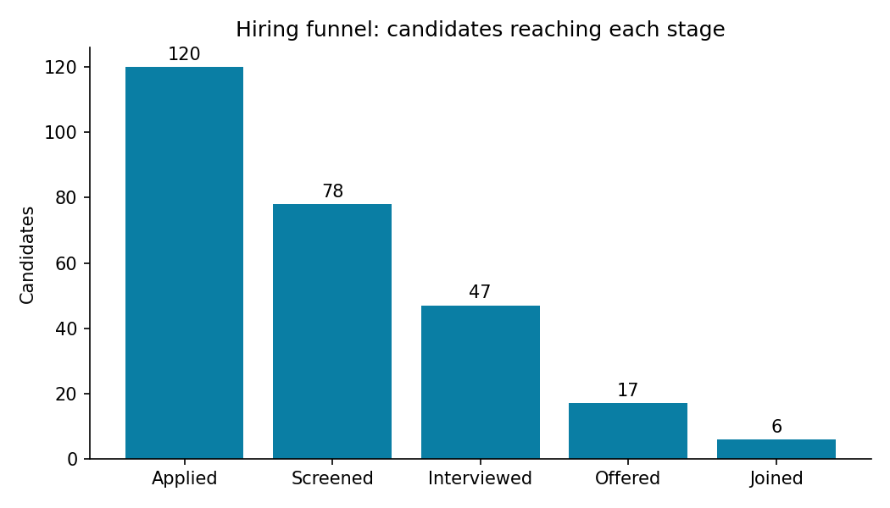

# Recruitment Pipeline Report

Total candidates: **120** | Data period: 06 Jun 2026 to 15 Aug 2026

## Hiring funnel
| stage | reached | step_conversion | overall_conversion |
|---|---|---|---|
| Applied | 120 | - | 1.0 |
| Screened | 78 | 0.65 | 0.65 |
| Interviewed | 47 | 0.603 | 0.392 |
| Offered | 17 | 0.362 | 0.142 |
| Joined | 6 | 0.353 | 0.05 |

## Sourcing channel effectiveness
| source | applicants | interviewed_plus | offered_plus | joined | interview_rate | offer_rate |
|---|---|---|---|---|---|---|
| LinkedIn | 35 | 15 | 4 | 1 | 0.429 | 0.114 |
| Employee Referral | 24 | 10 | 3 | 1 | 0.417 | 0.125 |
| Job Portal | 23 | 10 | 4 | 1 | 0.435 | 0.174 |
| Company Website | 22 | 9 | 4 | 2 | 0.409 | 0.182 |
| Campus Drive | 16 | 3 | 2 | 1 | 0.188 | 0.125 |

## Speed of process
- Average days from application to screening: **4.8**
- Average days from application to offer: **15.4**
- Screened within 5 days: **60%**

## Current outcomes
| outcome | candidates |
|---|---|
| Rejected | 61 |
| In Progress | 40 |
| Withdrawn | 13 |
| Joined | 6 |

_All data in this report is synthetic._
